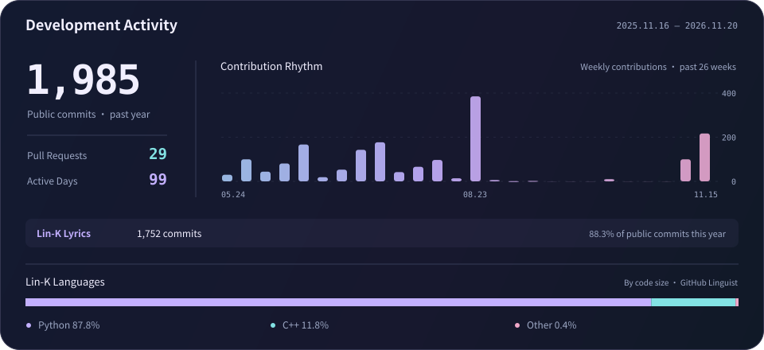

  
  

    <a href="https://github.com/karaoke-studio/karaoke-studio">项目源码 ↗</a>
    &nbsp; · &nbsp;
    <a href="https://github.com/karaoke-studio/karaoke-studio/releases/latest">下载最新版本 ↗</a>
  

   
  

